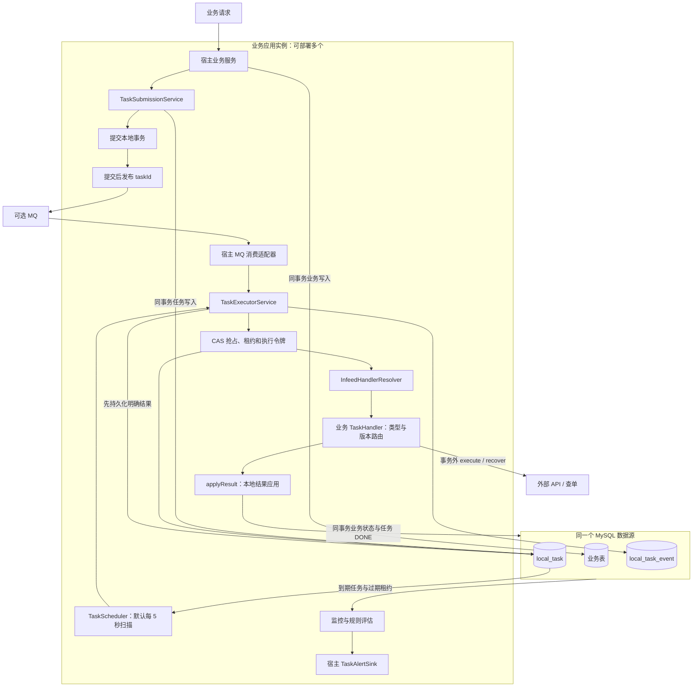
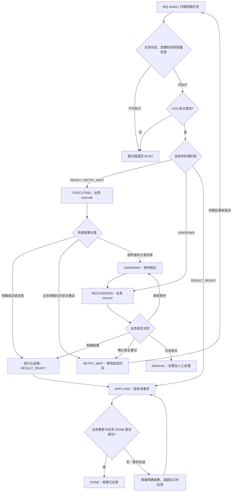
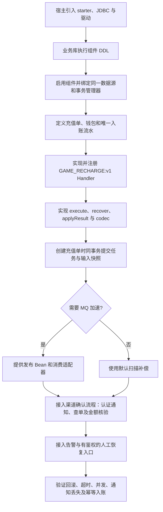
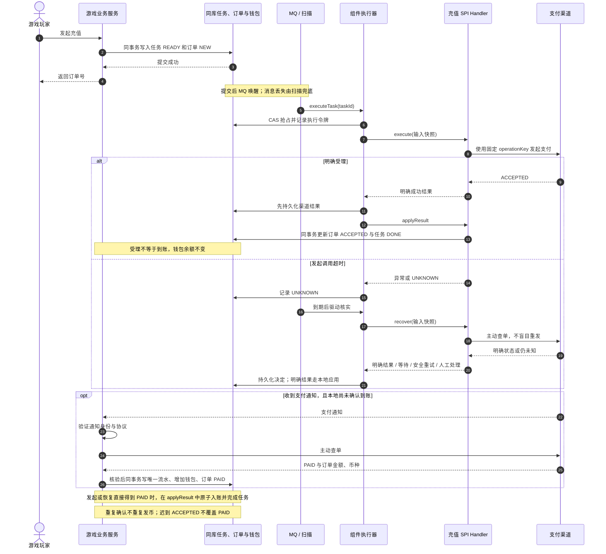

# api-decouper

一个嵌入业务应用的通用异步解耦组件。业务数据与任务表同事务提交，以 MQ 加速执行、以多实例每 5 秒数据库扫描兜底，通过 infeed-spi 扩展业务，通过 CAS 和执行令牌协调竞争。

原始框架保留在本地 `main`（`db18c8e`）；实现位于 `feature/reliable-local-tasks`。当前 SPI 和表结构替换了未完成的原型契约，不能直接覆盖旧表上线。

## 阅读导航

- [整体架构](#整体架构)
- [任务执行流程](#任务执行流程)
- [项目结构](#项目结构)
- [运行边界](#运行边界)
- [业务项目接入步骤](#业务项目接入步骤)
- [游戏充值案例](#游戏充值案例)
- [状态及重试](#状态及重试)
- [监控和告警](#监控和告警)
- [业务接入验收](#业务接入验收)
- [验证](#验证)

图表使用 Mermaid，GitHub 可直接渲染；本地阅读建议使用支持 Mermaid 的 Markdown 预览器。

## 整体架构

组件嵌入业务应用，复用宿主数据源和本地事务。数据库任务记录是可靠事实来源，MQ 仅用于加速唤醒。每个实例都可独立扫描，由数据库 CAS 和执行令牌协调执行权，无需分布式锁服务。



| 层次 | 责任 |
| --- | --- |
| 宿主业务 | 输入快照、业务幂等、渠道协议、结果核实、安全重试决定、状态更新 |
| 通用组件 | 同事务任务提交、双通道驱动、SPI 路由、CAS、租约、结果持久化、补偿及告警 |
| 基础设施 | MySQL 持久化与事务；可选 MQ 提供低延迟唤醒 |

提交后发布 MQ 与数据库提交不是一个分布式原子事务。消息发送失败或进程在提交后退出时，已提交任务仍由扫描驱动。外部调用也不与本地数据库构成原子事务，因此未知结果必须交给业务核实。

## 任务执行流程

MQ 与扫描共用执行入口。抢占失败、任务未到期或已完成时，不会再次调用外部 API；具体消息确认策略见接入步骤。



图中循环均受下一次执行时间、阶段次数预算和适用的任务年龄约束，不代表无限重试。执行或核实租约过期后进入 UNKNOWN；应用阶段租约过期则回到 RESULT_READY。超出预算进入 MANUAL。执行令牌阻止失去所有权的执行者覆盖新状态。

## 项目结构

```text
api-decouper/                          # Maven 父项目，packaging=pom
├── api-decouper-starter/               # 组件源码、自动配置、DDL、独立单元测试
└── api-decouper-starter-samples/       # 案例聚合父模块，packaging=pom
    ├── api-decouper-sample-support/    # 公共测试基座、显式数据库配置
    ├── api-decouper-sample-payment/    # 支付 Handler 与订单状态案例
    └── api-decouper-sample-reliability/# 事务、并发、重试、调度及告警验证
```

组件只依赖生产所需库，不依赖 samples。新增案例只需在 samples 父 POM 中注册子模块，依赖 starter；数据库测试按需以 test scope 引入 sample-support，不需要改组件代码或复用其他案例的测试类。

## 运行边界

- Java 8、Spring Boot 2.7、MySQL 8 / InnoDB；使用 Spring JDBC 的 `DataSourceTransactionManager`。
- 业务表与任务表必须同数据源、同事务管理器；组件拒绝无事务、只读事务或绑定错误数据源的提交。
- 外部调用在事务外运行；HTTP 连接、读取和总调用超时由业务网关实现配置。租约不是 HTTP 取消机制。
- 本地结果应用必须同步、只做短数据库操作；禁止 `@Async`、`REQUIRES_NEW`、远程调用或吞掉失败。
- 组件不承诺外部操作恰好一次。进程退出、超时或结果落库失败后，由业务核实外部事实；安全重发要求外部幂等或足够的业务证据。
- “任务完成”表示确定结果已应用本地，不等于支付成功。发起受理与最终到账是不同业务状态。

## 业务项目接入步骤

### 1. 确认接入条件并添加依赖

当前已验证 Java 8、Spring Boot 2.7、MySQL 8 / InnoDB，以及 JDBC 的 `DataSourceTransactionManager`。Spring Boot 3、JPA 事务管理器和跨数据库事务不属于当前已验证范围。业务表和组件任务表必须在同一个数据源、同一个事务管理器中提交。

业务项目添加以下依赖；示例假设宿主使用 Spring Boot 2.7 的依赖版本管理：

```xml
<dependency>
    <groupId>io.github.scorpioaeolus</groupId>
    <artifactId>api-decouper-starter</artifactId>
    <version>1.0-0.RELEASE</version>
</dependency>
<dependency>
    <groupId>org.springframework.boot</groupId>
    <artifactId>spring-boot-starter-jdbc</artifactId>
</dependency>
<dependency>
    <groupId>mysql</groupId>
    <artifactId>mysql-connector-java</artifactId>
    <scope>runtime</scope>
</dependency>
```

接入前需确保该版本的 starter 及其父 POM 可从本机或团队 Maven 仓库解析；不能假定当前实现已发布到公共仓库。starter 的 JDBC starter 为 provided，宿主负责 JDBC、连接池和数据库驱动。不需要依赖任何 samples 模块；`infeed-spi` 已由 starter 传递引入。如果业务使用 Jackson 编解码，需由宿主提供 Jackson，已有 Web starter 的项目通常已包含。

### 2. 创建任务表

由宿主通过 Flyway、Liquibase 或数据库发布平台执行 [V1__local_task.sql](api-decouper-starter/src/main/resources/db/mysql/V1__local_task.sql)，创建 `local_task` 和 `local_task_event`。组件不会自动建表，也不提供旧原型表的自动迁移。

每个业务应用可以使用自己的数据库，无需共享中心任务库。不要在业务环境运行 samples 的测试建表脚本。所有任务时间以数据库生成的 UTC epoch 毫秒存储，不依赖 JVM 时区。

### 3. 配置数据源并启用组件

宿主已有数据源时，在原有配置上添加：

```yaml
api-decouper:
  enabled: true
  data-source-bean: dataSource
  transaction-manager-bean: transactionManager
  poll-interval-millis: 5000
  concurrency: 8
  lease-millis: 30000
  batch-size: 100
  max-scan-tasks: 1000
  scan-budget-millis: 1000
  max-execute-attempts: 5
  max-recover-attempts: 20
  max-apply-attempts: 20
  max-task-age-millis: 86400000
  recovery-delay-millis: 5000
  backoff-millis: 1000
  max-backoff-millis: 60000
```

`data-source-bean` 与 `transaction-manager-bean` 是具体 Bean 名称；必须指向同一个数据源。多数据源项目应显式指定承载业务表和任务表的数据源。事务管理器可以由宿主显式提供：

```java
@Bean("transactionManager")
public DataSourceTransactionManager transactionManager(
        @Qualifier("dataSource") DataSource dataSource) {
    return new DataSourceTransactionManager(dataSource);
}
```

启用后自动装配提交服务、执行器、扫描器和监控服务，不需要额外添加 `@EnableScheduling`。

`scheduling-enabled: false` 可关闭自动轮询/监控，用于宿主自己调用 `scan()` 和 `evaluate()`。每个实例均可扫描，数据库 CAS 决定执行者，无需 Redis 锁或单一调度主节点。

### 4. 实现并注册业务 SPI Handler

下面为接口职责示意，`gateway`、订单服务和 `codec` 由业务实现并注入；完整实现见后面的案例链接。

```java
@Component
@BizSpi(name = "PAYMENT_INIT:v1")
public class PaymentInitHandler implements TaskHandler<PaymentRequest, PaymentReply> {
    public ExecutionResult<PaymentReply> execute(TaskContext ctx, PaymentRequest request)
            throws Exception {
        // operationKey 在全部尝试中固定，按网关协议作为外部幂等键。
        return ExecutionResult.success(gateway.initiate(ctx.getOperationKey(), request));
    }
    public RecoveryDecision<PaymentReply> recover(TaskContext ctx, PaymentRequest request)
            throws Exception {
        // 查询只是示意；应按外部协议分类，查询不到不能直接推断可以重发。
        return RecoveryDecision.manual("QUERY_REQUIRED");
    }
    public void applyResult(TaskContext ctx, PaymentRequest request,
                            ExecutionResult<PaymentReply> result) {
        // 同库条件更新，前置状态检查，终态不得被迟到结果覆盖。
    }
    public TaskCodec<PaymentRequest, PaymentReply> codec() {
        return codec; // 显式类型 JSON 编解码，验证输入/结果版本，不启用任意类名反序列化。
    }
}
```

完整可运行示例位于 [PaymentExample.java](api-decouper-starter-samples/api-decouper-sample-payment/src/main/java/com/api/decouper/examples/PaymentExample.java)，配套 [PaymentScenarioIT.java](api-decouper-starter-samples/api-decouper-sample-payment/src/test/java/com/api/decouper/PaymentScenarioIT.java)。示例采用 BigDecimal、明确外部结果分类，并保护 PAID 等终态，不会打包成宿主默认业务 Bean。

Handler 必须通过 `@Component` 或 `@Bean` 注册为 Spring Bean，并位于宿主扫描范围内。samples 的类不会自动成为宿主业务 Bean，复制案例时需自行注册。

| 方法 | 执行环境 | 业务职责 |
| --- | --- | --- |
| `execute` | 事务外 | 调用外部 API，判断明确结果、未知结果或安全重试 |
| `recover` | 事务外 | 主动查单核实，决定继续等待、安全重试或人工处理 |
| `applyResult` | 组件本地事务内 | 条件更新业务状态，与任务 DONE 一起提交 |
| `codec` | 输入与结果编解码 | 校验版本，使用明确类型，保证历史任务可读取 |

`applyResult` 中只做短本地数据库操作，不远程调用、不使用 `@Async` 或 `REQUIRES_NEW`，失败必须向外抛出，以便整个本地事务回滚。

组件自动把 `@BizSpi` Handler 注册进真实 infeed-spi 容器并精确解析 `bizType + ":v" + handlerVersion`。不需要为本组件额外启用 infeed 广播代理。实现缺失、条件不满足和同名冲突明确报错；不允许多实现匹配后广播支付请求。

默认 infeed 容器是 JVM 全局容器；若其他 Spring 上下文已注册任务 Handler，启动会拒绝跨上下文路由。多上下文宿主应显式提供独立的 `ISpiContainer` Bean 或 `HandlerResolver`。旧任务未清理前，应保留对应的 Handler 版本；同名版本的业务语义须保持兼容。

### 5. 在业务事务中提交任务

下面为业务代码示意，输入编码和订单仓储由宿主实现：

```java
@Transactional(transactionManager = "transactionManager")
public long createRecharge(RechargeRequest request) {
    String payload = encodeStablePayload(request);
    long taskId = taskSubmissionService.submit(new TaskRequest(
        "GAME_RECHARGE",                    // 业务类型
        1,                                  // Handler 版本
        request.orderId,                    // 业务订单 ID
        "GAME_RECHARGE:" + request.orderId,  // 全局唯一操作键
        payload,                            // 持久化输入快照
        1                                   // 输入版本
    ));
    rechargeRepository.createIdempotently(request);
    return taskId;
}
```

该方法必须通过 Spring 事务代理调用，同一个类内部自调用不能依赖 `@Transactional` 开启事务。`submit` 强制要求已有可写事务，业务写入和任务任一步失败都会一起回滚。先获取任务行、再操作业务订单，有助于与结果应用保持“任务→业务订单”的加锁顺序。

任务记录中的 `bizType=GAME_RECHARGE` 和 `handlerVersion=1` 精确路由到 `@BizSpi(name="GAME_RECHARGE:v1")`。扫描器读取记录后，通过 `codec` 还原输入，再调用该 Handler 的 `execute` / `recover` / `applyResult`；不需要持久化 Java 方法名或回调对象。

`operationKey` 是区分业务操作的全局唯一幂等键。同键、同路由、同业务 ID、同输入版本及相同输入字符串返回已有任务 ID；不同输入拒绝，组件以 MANDATORY 事务边界标记失败回滚，即使调用方捕获提交冲突，外层事务也不能提交这次业务变更。若 JSON 键序可能变化，宿主提交前先规范化序列化。任务和幂等键不会自动删除。

### 6. 接入 MQ（可选）

可以先不接 MQ，仅靠扫描跑通业务。需要 MQ 时，宿主提供发送器，例如以下伪代码中的 `YourMessageClient` 代表自己的 MQ 客户端：

```java
@Bean
public TaskMessagePublisher taskMessagePublisher(YourMessageClient client) {
    return taskId -> client.send("api-decouper-task", Long.toString(taskId));
}
```

宿主可选提供 `TaskMessagePublisher` Bean，发送仅包含 taskId 的唤醒消息。组件只在事务提交后调用它，发送失败由轮询兜底；发送器只负责发消息，不在原事务提交回调中同步执行任务。

消费者解析 taskId 后，在业务事务外同步调用 `taskExecutorService.executeTask(taskId)`，根据返回的 `TaskTriggerResult` 执行自己的 ACK/NACK 策略：DONE、ADVANCED、SKIPPED、NOT_FOUND 可确认消息，BUSY 建议退避重投；基础设施异常向外传播，适配器应请求重投。NOT_FOUND 建议宿主记录异常消息，但数据库任务仍为可靠事实来源。重复消息不会绕过任务状态、CAS 或下一次执行时间。

也可以完全不配置 MQ，单靠轮询完成任务。组件不绑定某一 MQ 产品；Kafka、RocketMQ 等发送/消费协议由宿主适配。

### 7. 更新业务结果与最终到账

充值场景需区分两个事实：渠道受理后订单进入 ACCEPTED，任务可以完成，但不能发币；渠道确认支付成功后，核验订单号、金额、币种，再将订单 PAID、入账流水和钱包余额在同一事务更新。

渠道通知可作为主动查单的触发器。通知身份认证、签名验证、渠道查单协议及到账规则由业务负责。重复通知必须幂等，迟到的受理结果不得覆盖 PAID。组件负责可靠驱动，不能替业务判断超时是否允许重新发起支付。

游戏充值完整实现：

- [GameRechargeHandler.java](api-decouper-starter-samples/api-decouper-sample-payment/src/main/java/com/api/decouper/examples/game/GameRechargeHandler.java)：SPI 路由、外部调用、查单核实、结果分类与编解码。
- [GameRechargeService.java](api-decouper-starter-samples/api-decouper-sample-payment/src/main/java/com/api/decouper/examples/game/GameRechargeService.java)：同事务创建订单和任务、终态保护、幂等钱包入账。
- [游戏充值验证](docs/game-recharge-validation.md)：15 个验证场景及模拟渠道边界。

## 游戏充值案例

固定服务端商品为 **10.01 CNY 兑换 1000 游戏币**。案例使用真实 MySQL 和本地 HTTP 渠道模拟器，MQ 用内存队列模拟，不涉及真实资金交易。

### 案例接入流程



`bizType=GAME_RECHARGE`、`handlerVersion=1` 路由至 `@BizSpi(name="GAME_RECHARGE:v1")`。持久化的输入快照提供订单、玩家、商品、金额及游戏币数量，扫描无需知道 Java 回调方法名。

### 充值运行时序



通知可能早于发起结果，也可能丢失。案例验证了提前通知、超时后查得 PAID、并发通知及入账回滚。实际渠道的签名、鉴权、查询语义与重试许可由宿主实现，不能直接套用模拟协议。

完整实现及 15 个场景详见 [游戏充值验证](docs/game-recharge-validation.md)。

## 状态及重试

```text
READY / RETRY_WAIT -> EXECUTING -> RESULT_READY -> APPLYING -> DONE
                           |             ^           |
                           v             |           +-- 本地失败后只补结果应用
                        UNKNOWN -> RECOVERING
                                    |    |
                                    |    +-- 业务确认安全 -> RETRY_WAIT
                                    +-- 明确结果 / 继续等待 / MANUAL
```

- execute 返回 SUCCESS / FAILURE 为确定结果，先落库再应用本地；FAILURE 同样可最终完成任务。
- RETRY 必须给出时间和安全原因；UNKNOWN 和未分类异常进入核实。recover 默认 MANUAL。
- EXECUTING / RECOVERING 租约过期进入 UNKNOWN；APPLYING 租约过期只回 RESULT_READY。
- 执行令牌阻止旧执行者覆盖新状态。结果应用在短事务中锁定任务行、校验所有权，业务状态和 DONE 一起提交。
- 三阶段次数独立；超出预算进入 MANUAL。最大任务年龄限制新外部调用，已产生的外部效果仍可核实和应用。
- 本地结果失败采用指数退避及抖动；业务可返回外部重试时间，组件不会根据异常类型猜测重发安全性。
- `TaskRecoveryService.resume(id, expectedVersion, reason)` 仅供宿主鉴权后的运维入口调用：保留确定结果，无结果则先核实；开启新的核实/应用预算，不清空外部执行次数。事件记录操作原因。没有默认公开 HTTP 接口。

`local_task_event` 记录阶段变更、执行令牌、版本及结果分类。异常仅存稳定代码，不存原始请求、堆栈或密钥；业务提供的原因也应为脱敏稳定代码。输入和结果最大为 65535 字符。

## 监控和告警

`TaskMonitoringService.snapshot()` 返回低基数聚合指标；`RuntimeSignals` 提供 CAS 竞争、MQ 失败和扫描健康信号，可由宿主桥接现有指标系统。

内置规则：BACKLOG、OLD_PENDING、LEASE_EXPIRED、LONG_RUNNING、UNKNOWN_AGE、APPLY_FAILURES、MANUAL、BUDGET_EXHAUSTED、ROUTE_ERROR、MQ_UNAVAILABLE、SCAN_STALLED、WORKER_FAILURE。

```yaml
api-decouper:
  alert-threshold-millis: 60000  # 等待/未知状态和基础设施异常的时间阈值
  alert-window-millis: 10000    # 持续达到条件后告警
  alert-cooldown-millis: 300000 # 聚合去重后的重复提醒间隔
  backlog-threshold: 1000
  alert-count-thresholds:
    APPLY_FAILURES: 3
  disabled-alert-rules: []
```

宿主提供 `TaskAlertSink` Bean 即可接入自己的告警平台，发送器应配置调用超时，避免阻塞监控线程；默认结构化日志，发送异常不影响任务状态。健康恢复后发送恢复事件；数据库查询失败仅更新已观测的基础设施规则，不把未观测的任务规则误判为恢复。LONG_RUNNING 独立于租约，持续续租的卡住任务仍可告警。CAS 正常竞争仅计数。告警在各实例内聚合；多实例部署可在宿主告警平台进一步去重。监控状态重启后重建，不承诺告警外部投递恰好一次。

生产建议对任务表建立保留、归档策略，监控查询和扫描索引成本；不要直接清除唯一幂等键。数据库不可用、执行容量耗尽和业务不可核实等情况会延长恢复时间，“5 秒”是默认轮询间隔，并非完成时间上限。

## 业务接入验收

完成接入后，至少在业务项目中验证：

1. 本地外层事务回滚后，业务单、任务和唤醒消息都不存在。
2. MQ 关闭或发送失败后，扫描仍能执行任务。
3. 重复消息和多实例扫描并发时，不会绕过 CAS 和执行时间限制。
4. 外部超时后先核实，不直接重复发起支付；查询不到也不能直接推断未受理。
5. 本地结果更新失败时，业务更新回滚；后续只补应用已持久化结果，不重复调用外部 API。
6. 重复到账通知不重复发币，迟到结果不覆盖业务终态。
7. 持续失败、未知状态和人工任务能触发宿主告警，人工恢复入口有鉴权和操作原因。

## 验证

默认构建编译全部模块并运行单元测试，不连接数据库：

```bash
mvn clean test
# 只验证组件：
mvn -pl api-decouper-starter -am clean test
```

MySQL 案例只连接用户已经启动的实例，不创建、启动、停止或删除容器。使用专用测试库及仅获该库权限的账号，通过环境变量提供配置：

```bash
export DECOUPER_TEST_JDBC_URL='jdbc:mysql://127.0.0.1:3306/api_decouper_test?serverTimezone=UTC'
export DECOUPER_TEST_USERNAME='<专用测试账号>'
# 通过本机环境/秘密管理器设置 DECOUPER_TEST_PASSWORD，不提交密码。
export DECOUPER_TEST_ALLOW_RESET=true
bash scripts/mysql-test.sh
```

`ALLOW_RESET` 表示允许测试在指定库内重建任务表、清空示例订单表；不会创建数据库或修改账号权限。缺少连接或账号配置时，在连接前失败；没有默认 root、密码或备用数据库。系统数据库会被拒绝。

单独运行某个案例并自动构建其依赖：

```bash
bash scripts/mysql-test.sh -pl api-decouper-starter-samples/api-decouper-sample-payment -am
bash scripts/mysql-test.sh -pl api-decouper-starter-samples/api-decouper-sample-reliability -am
```

测试会重建 local_task、local_task_event，清空 sample_order，并由游戏案例重建 game_wallet、game_recharge_order、game_credit_ledger；仅对专用空测试库使用。SQL 权限需求为该库的 SELECT、INSERT、UPDATE、DELETE、CREATE、DROP、ALTER、INDEX，不需要全局或 root 权限。同一台机器上，公共基座以本地进程锁保护同一测试库的完整测试生命周期，支持 Maven `-T` 或 JUnit 并行调度而不互相重建表；不同机器同时测试则使用各自独立数据库。此锁只在 samples 中，不进入 starter。

验证型 samples 通过 `*IT` 运行；未启用 mysql-it 时不执行数据库案例。组件单元测试、案例支持单元测试、支付案例和可靠性案例分模块隔离。设计与实现计划位于 `docs/superpowers/`，需求验收记录位于 `docs/acceptance.md`。

游戏业务完整案例见 [游戏充值验证](docs/game-recharge-validation.md)：本地订单提交、异步支付发起、超时查单、到账核验及幂等钱包入账。
